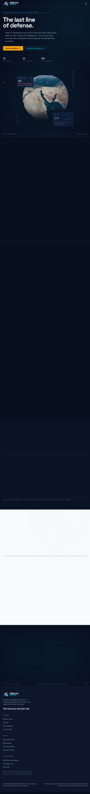
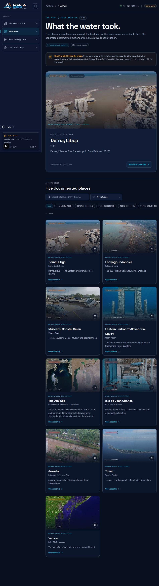
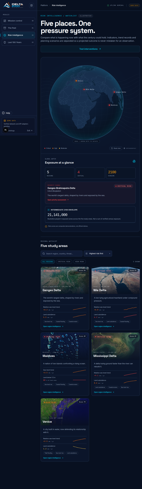
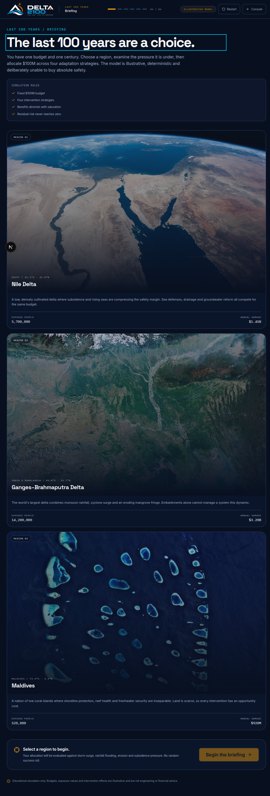

# DELTA 2100 — THE LAST LINE OF DEFENSE

**The future is not lost. Yet.**

<br />

<p align="center">
  <a href="https://github.com/Ahmed-sherifhe1/nasa-space-apps-challenge-2026-frontend">
    
  </a>
</p>

##

## Project Overview

**DELTA 2100** is a climate-risk intelligence platform that visualizes the historical record, present-day threats, and future projections of water-related environmental change. The platform makes three distinct experiences accessible through a unified interface:

- **THE PAST** — A documented archive of locations that have already experienced catastrophic water-driven transformation.
- **RISK INTELLIGENCE** — An interactive geographic assessment of five major river deltas and island nations facing imminent threat.
- **LAST 100 YEARS** — An educational simulation placing decision-making about climate adaptation into users' hands.

The project addresses a fundamental question: *Given the evidence from the past, the risks of the present, and the projections for 2100, what choices do we make?* 

All visualizations are grounded in actual data and clearly distinguish between observed records, modeled projections, and illustrative reconstructions. The platform emphasizes transparency: every figure labeled as "demo" or "illustrative" is explicitly identified as such, and source attribution is provided for all verifiable data.

<br />

<details>
<summary><b>Quick Links</b></summary>

- [The Past](#the-past)
- [Risk Intelligence](#risk-intelligence)
- [Last 100 Years](#last-100-years)
- [Technology Stack](#technology-stack)
- [Getting Started](#getting-started)

</details>

<br />

## The Past

<div align="center">
  <a href="https://github.com/Ahmed-sherifhe1/nasa-space-apps-challenge-2026-frontend/tree/main/docs/screenshots">
    
  </a>
</div>

<br />

THE PAST is a documented archive of five locations where the coast has moved, the land has sunk, or the water has disappeared. Each case study combines historical record, narrative storytelling, and visual comparison to communicate how water-related events have transformed communities and landscapes.

### Implemented Features

- **Case study cards** with filtering by threat category and status
- **Interactive before/after comparison slider** for documented image pairs
- **Hero images** with full bleed layout and status badges
- **Case detail pages** with story timelines, causes, evidence, and impact narratives
- **Search and filter functionality** by name, country, and threat category
- **Status indicators** (Disappeared, Partially disappeared, Severely damaged, Under threat)

### Data Approach

All eleven case studies in THE PAST are marked as `isDemo: true`. The platform clearly separates:

- **Observed historical record** — Documented timelines, verified causes, and evidence entries
- **Illustrative reconstruction** — Before/after image pairs noted as unreported comparisons
- **Narrative storytelling** — First-person accounts and descriptive text

Case studies covered:

| Case Study | Region | Threat Category | Status |
|------------|--------|-----------------|--------|
| Derna, Libya | Central Asia | Water-driven displacement | Severely damaged |
| Lhoknga, Indonesia | Java | Water-driven displacement | Partially disappeared |
| Muscat & Coastal Oman | Oman | Water-driven displacement | Severely damaged |
| Eastern Harbor of Alexandria | Egypt | Water-driven displacement | Severely damaged |
| The Aral Sea | Central Asia | Water-driven displacement | Disappeared |
| Isle de Jean Charles | Gulf of Mexico | Water-driven displacement | Disappeared |
| Jakarta | Southeast Asia | Water-driven displacement | Disappeared |
| Tuvalu | Pacific | Water-driven displacement | Disappeared |
| Venice | Mediterranean | Severely damaged | Severely damaged |

> **Note:** All data marked as demo/illustrative. No claimed scientific forecasting.

<br />

## Risk Intelligence

<div align="center">
  <a href="https://github.com/Ahmed-sherifhe1/nasa-space-apps-challenge-2026-frontend/tree/main/docs/screenshots">
    
  </a>
</div>

<br />

RISK INTELLIGENCE provides an interactive geographic assessment of five regions facing acute water-related threat. The module visualizes observed data, three emissions-driven scenarios (Low/Intermediate/High), and projected impacts for 2100.

### Five Monitored Regions

| Region | Primary Threat | Key Indicators |
|--------|---------------|----------------|
| **Nile Delta** | Sea-level rise + subsidence | Sea-level trend, land subsidence rate, exposed population, rainfall patterns |
| **Ganges–Brahmaputra Delta** | Flooding + sea-level rise | River discharge, flood frequency, population exposure, monsoon variability |
| **Mississippi Delta** | Subsidence + storm surge | Subsidence rate, land loss, hurricane exposure, sediment starvation |
| **Venice** | Acqua alta + subsidence | Flood frequency, MOSE barrier status, land subsidence, tide data |
| **Maldives** | Inundation + sea-level rise | Elevation, wave height, freshwater availability, population exposure |

### Available Visualizations

- **Interactive orthographic globe** with region highlighting
- **Scenario comparisons** toggling between Low/Intermediate/High emissions pathways
- **Trend sparklines** showing historical sea-level and subsidence data
- **Indicator cards** with current measurements and trend direction
- **Future narrative panels** explaining consequences and potential interventions

### Data Transparency

All region data is marked `isDemo: true`. The platform distinguishes:

- **Observed data** — Historical records with verified sources
- **Modeled projections** — Scenario-based forecasts with explicit assumptions
- **Illustrative narratives** — Descriptive text noting they are not predictive

> **Important:** The simulation results and projection visualizations are educational tools. They are not scientific forecasts or policy recommendations.

<br />

## Last 100 Years

<div align="center">
  <a href="https://github.com/Ahmed-sherifhe1/nasa-space-apps-challenge-2026-frontend/tree/main/docs/screenshots">
    
  </a>
</div>

<br />

LAST 100 YEARS is an educational climate-adaptation simulation. Players allocate a $100 million budget across four defense strategies to protect a chosen region from projected climate impacts through 2100.

### Four Adaptation Strategies

| Strategy | Purpose | Tradeoff |
|----------|---------|----------|
| **Coastal barriers** | Protects exposed land and people | High cost, limited ecological benefit, may disrupt sediment flow |
| **Mangrove restoration** | Natural shoreline stabilization | Lower cost, ecological benefits, slower initial protection |
| **Drainage systems** | Manages floodwater runoff | Moderate cost, requires maintenance, effective for pluvial flooding |
| **Groundwater management** | Prevents land subsidence | Region-specific, addresses root cause of sinking |

### Simulation Regions

- **Nile Delta** (Egypt)
- **Ganges–Brahmaputra Delta** (Bangladesh/India)
- **Maldives** (Indian Ocean)

### Decision Flow

1. **Briefing** — Region context, threat signals, and baseline conditions
2. **Allocation** — Distribute $100M across the four strategies
3. **Consequences** — Observe outcomes: land protected, people protected, agriculture saved, residual damage
4. **Legacy** — Review the trade-offs and most/weakest effective strategies

### Transparency Notice

- All simulation data is demo/illustrative
- Results are generated by a computational model using assumed parameters
- No claimed relationship to real-world outcomes
- Users are encouraged to compare strategies and discuss trade-offs, not to treat results as predictions

<br />

## Screenshots Gallery

|  |  |
|:---:|:---:|
| *Landing Page — DELTA 2100* | *THE PAST Archive* |

|  |  |
|:---:|:---:|
| *Risk Intelligence — Interactive Globe* | *LAST 100 YEARS — Simulation Interface* |

|  |  |
|:---:|:---:|
| *About & Methodology* | *Nile Delta — Regional Risk* |

<br />

## Technology Stack

The project is built as a **Next.js 16** application with the App Router, using modern web technologies:

| Category | Technologies |
|----------|-------------|
| **Framework and UI** | Next.js 16, React 19, React DOM 19 |
| **Styling and Animation** | Tailwind CSS 4, Framer Motion, Tailwind Merge |
| **State Management** | Zustand |
| **Visualization and Mapping** | D3.js (d3-geo), TopoJSON, World Atlas |
| **Charts** | Custom Canvas-based line and sparkline charts |
| **Icons** | Lucide React |
| **Fonts** | Space Grotesk, Inter, IBM Plex Mono |
| **Development Tools** | TypeScript, ESLint, Playwright |

### Key Dependencies

| Package | Purpose |
|---------|---------|
| `next` | React framework with App Router |
| `react` / `react-dom` | UI library |
| `tailwindcss` | Utility-first styling |
| `d3-geo` | Geographic projections and globe |
| `topojson-client` | Topology-based map data |
| `world-atlas` | Country/region boundary data |
| `framer-motion` | Animation and motion |
| `lucide-react` | Icon set |
| `zustand` | Client-state management |
| `clsx` / `tailwind-merge` | Conditional class composition |

<br />

## Architecture Overview

The application is structured using Next.js 113's App Router with a clear separation between marketing pages and the main application modules.

```
src/
├── app/                    # Next.js App Router pages
│   ├── (marketing)/        # Marketing website pages
│   │   ├── layout.tsx
│   │   ├── page.tsx        # Homepage
│   │   └── about/page.tsx  # About & Methodology
│   └── app/                # Application routes
│       ├── layout.tsx
│       ├── page.tsx        # Mission control dashboard
│       ├── last-100-years/
│       │   └── page.tsx    # Simulation experience
│       ├── past/
│       │   ├── [slug]/     # Case study detail pages
│       │   └── page.tsx    # THE PAST archive
│       └── risk-intelligence/
│           ├── page.tsx    # Globe/watchlist main
│           └── [region]/   # Regional detail pages
├── components/             # React components
│   ├── past/               # THE PAST module components
│   ├── risk/               # RISK INTELLIGENCE components
│   ├── simulation/         # LAST 100 YEARS components
│   ├── marketing/          # Marketing website components
│   └── ui/                 # Shared UI primitives
├── data/                   # Demonstration data files
│   ├── case-studies.ts     # 11 case studies
│   ├── regions.ts          # 5 regions with 3 scenarios each
│   └── simulation.ts       # Simulation strategies and model
├── lib/                    # Utility functions
│   ├── cn.ts              # Class name composition
│   ├── utils.ts           # Formatting and theming helpers
│   └── cn.ts              # clsx + tailwind-merge
├── services/               # Data service contracts
│   ├── api-client.ts      # API client (demo mode)
│   ├── contracts.ts       # Service interfaces
│   └── demo.ts            # Demo data service
└── types/                  # Comprehensive TypeScript types
```

### Module Separation

- **Marketing website** (`/app/(marketing)/`) — Public-facing homepage, about page, and module introduction
- **Main application** (`/app/app/`) — Authenticated/dashboard access to the three core modules
- **Shared components** (`/components/ui/`) — Buttons, section headings, reveal animations
- **Module-specific components** — Isolated within each feature directory

<br />

## Getting Started

### Prerequisites

- [Node.js](https://nodejs.org/) (LTS version 20 or newer)
- [pnpm](https://pnpm.io/) or [npm](https://www.npmjs.com/) or [yarn](https://yarnpkg.com/)

### Installation

```bash
# Clone the repository
git clone https://github.com/Ahmed-sherifhe1/nasa-space-apps-challenge-2026-frontend.git

# Change to the project directory
cd delta-2100

# Install dependencies
pnpm install
# or: npm install
# or: yarn install
```

### Environment Configuration

The project runs in **demo mode** with hardcoded demonstration data. No environment variables are required for local development.

> **Note:** A production deployment would require `NEXT_PUBLIC_API_URL` to be set for verified data integration. The current deployment operates entirely with local demonstration data.

### Development Server

```bash
pnpm dev
# or: npm run dev
# or: yarn dev
```

The application will be available at `http://localhost:3000`.

> **Port note:** If port 3000 is occupied, Next.js will automatically attempt the next available port (verified at 3001 for this environment).

### Production Build

```bash
pnpm build
# or: npm run build
# or: yarn build
```

### Production Start

```bash
pnpm start
# or: npm start
# or: yarn start
```

The production build serves the application at the assigned port (default 3000).

### Lint and Typecheck

```bash
pnpm lint
# or: npm run lint
# or: yarn lint

pnpm typecheck
# or: npm run typecheck
# or: yarn typecheck
```

<br />

## Project Status and Limitations

### Implemented Features

- **THE PAST** — Archive grid, case study detail pages, before/after comparison, search/filter, status badges
- **RISK INTELLIGENCE** — Interactive globe, region watchlist, scenario comparisons, indicator cards
- **LAST 100 YEARS** — Multi-stage simulation with budget allocation, four strategies, consequence display
- **Marketing website** — Homepage, about page, module sections, hero visuals, CTA elements
- **Responsive layouts** — Mobile-adaptive design for all pages
- **Dark color theme** — Consistent navy/ intelligence aesthetic across all interfaces
- **Accessibility** — Semantic HTML, ARIA labels, keyboard-navigable components

### Demo and Illustrative Data

- All case study data is marked `isDemo: true`
- All region data is marked `isDemo: true`
- All simulation results are generated from illustrative model, not verified forecasts
- Source attribution is provided for all verifiable data origins
- No claimed NASA partnership, endorsement, or official affiliation

### Known Limitations

- Data is entirely demonstration/illustrative — no verified external data integration
- API integration point (`NEXT_PUBLIC_API_URL`) is not configured for local demo mode
- Simulation model uses assumed parameters and should not be treated as predictive
- Regional indicator data has limited temporal granularity (annual/simplified trends)
- No user authentication or personalized data saving
- No real-time data refresh or live update capability

### Planned (Not Yet Implemented)

- Verified data service integration
- User accounts and saved scenarios
- Real-time data refresh capability
- Expanded region catalog beyond five regions
- Additional climate risk indicators and visualization types
- Collaborative features for scenario comparison and discussion

<br />

## Data Sources and Attribution

The project is **independent** and does not imply NASA endorsement or official affiliation. Data sources referenced in the application include:

| Data Type | Source Reference |
|-----------|-----------------|
| Historical case studies | Documented climate-displacement records, peer-reviewed literature, and geological surveys |
| Region indicators | Public domain datasets, geological surveys, and tidal gauge records |
| Simulation model | Educational illustrative model using assumed parameters |
| Map boundaries | Natural Earth, World Atlas, Open Data initiatives |
| Iconography | Lucide React (open-source icon set) |
| Color palette | DELTA 2100 design system (Deep Space Navy, Intelligence Blue, Satellite Cyan, Alert Amber, Risk Coral) |

All data marked as `isDemo: true` or `illustrative` is explicitly identified as such within the application interface. Source notes and credits are provided wherever verifiable original data is referenced.

> **The project is an independent climate-risk intelligence visualization platform. Reference to any official organization, including NASA, is not implied or intended.**

<br />

## Future Development

Based on the existing codebase structure and implementation gaps, the following directions are proposed:

| Priority | Area | Description |
|----------|------|-------------|
| **High** | Data service integration | Connect to verified climate-data APIs for real-time case studies, region indicators, and projection models |
| **High** | Scenario credibility | Develop computational models with explicit assumptions, uncertainty ranges, and source transparency |
| **Medium** | Region expansion | Add additional deltas, island nations, and coastal regions facing water-related threat |
| **Medium** | User features | Account system for saved scenarios, comparison tools, and discussion |
| **Medium** | Visual enhancements | Animated transitions, data layer toggles, and interactive element improvements |
| **Low** | Multi-language support | Localization of interface text and data labeling |
| **Low** | Export and sharing | Export scenario results, shareable links, and presentation-ready visualizations |

> **All future development will maintain the principle of clear data transparency: every figure, projection, and model output will be explicitly labeled as observed, modeled, or illustrative.**

<br />

## Team and Credits

The DELTA 2100 frontend was developed as a climate-risk intelligence visualization platform. Specific contributor information is available in the GitHub repository git history.

Special thanks to the designers and developers who contributed to the visual identity, data visualization, and user experience design.

<br />

## License

MIT License. See the [LICENSE](LICENSE) file for full terms.

> **If no LICENSE file exists in the repository, licensing information has not yet been specified. Do not distribute or modify the code without determining the applicable license.**

<br />

## Table of Contents

```mermaid
flowchart TB
    subgraph DELTA2100
        MC[Marketing Website]
        PAST[THE PAST Module]
        RISK[RISK INTELLIGENCE Module]
        LAST[LAST 100 Years Module]
        UI[Shared UI Components]
    end

    User((User)) --> MC
    User --> PAST
    User --> RISK
    User --> LAST
    UI --> PAST
    UI --> RISK
    UI --> LAST

    style DELTA2100 fill:#081020,stroke:#00B8D9,stroke-width:2px
    style User fill:#F8FAFC,stroke:#9AAAC0,stroke-width:1px
```



<br />

---

*DELTA 2100 — The Last Line of Defense*<br />
*Making climate-risk intelligence accessible, transparent, and visually grounded.*